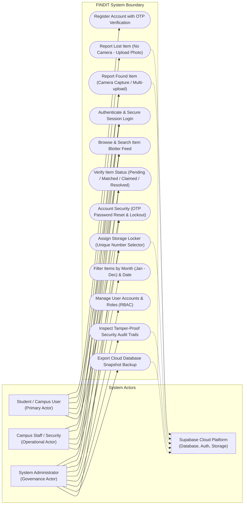
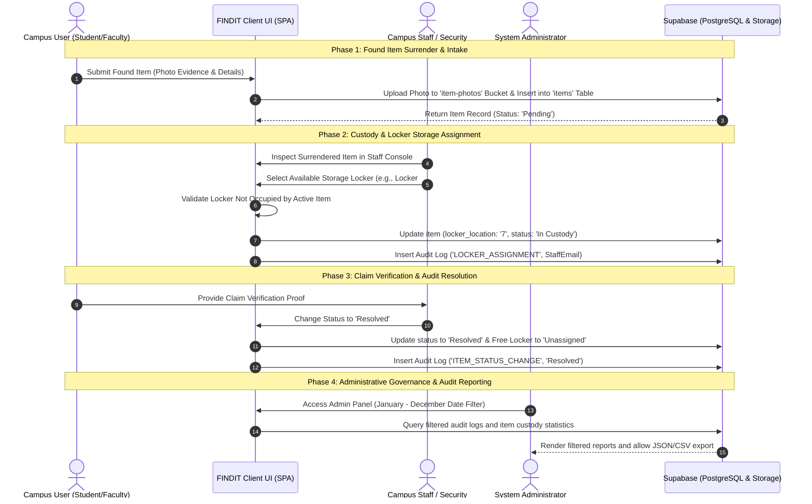
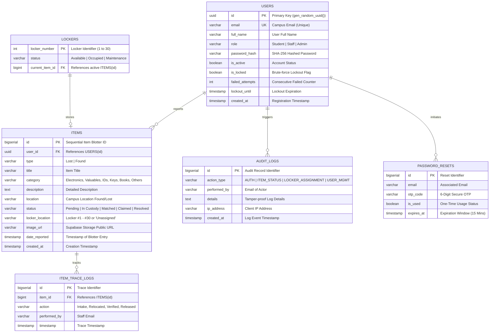
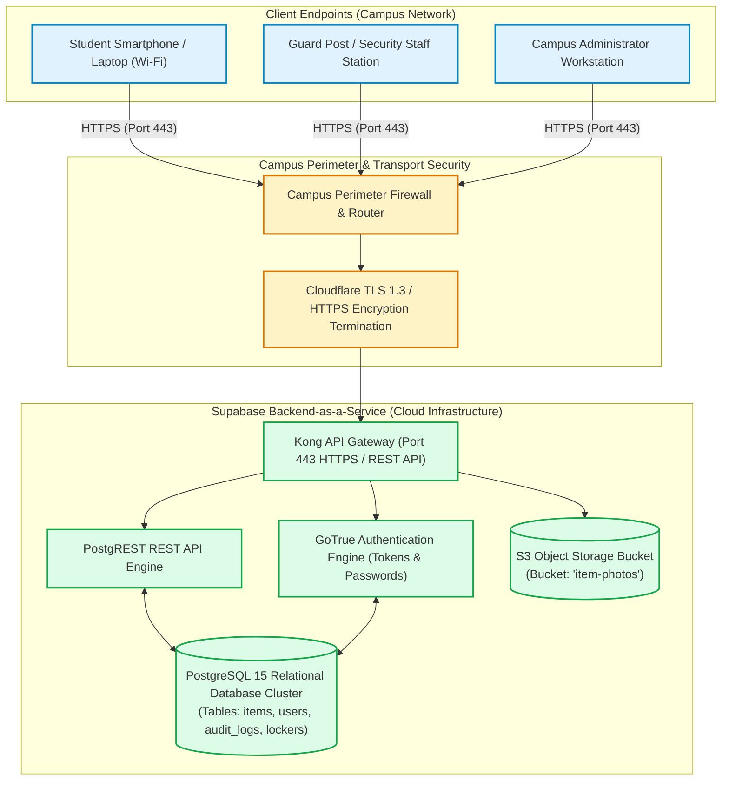

# SYSTEM INTEGRATION AND ARCHITECTURE (SIA) & IAS
## Final Project Implementation Checklist & Technical Documentation

**System Title:** **FINDIT: Campus Lost & Found Retrieval, Custody Tracking & Storage Locker Management System**  
**Course Code:** System Integration and Architecture 1 (SIA) / Information Assurance & Security 1 (IAS)  
**Database & Backend Engine:** Supabase PostgreSQL & Cloud Storage  

---

## Implementation Checklist Status

| Component | Standard / Notation | Status |
| :--- | :--- | :--- |
| **1. Use Case Diagram** | Standard UML Use Case with primary/secondary actors & boundary | Completed |
| **2. System Flow Diagram** | Swimlanes & Pools (User, Staff, Admin, Supabase Cloud) | Completed |
| **3. Entity Relationship Diagram (ERD)** | Relational Schema (PKs, FKs, Data Types, Relationships) | Completed |
| **4. System Flowchart** | Standard Flowchart Symbols (Process, Decisions, I/O, Storage) | Completed |
| **5. Network Diagram** | Physical & Logical Network Flow (Clients, Routers, Cloud SSL/TLS) | Completed |

---

## 1. Use Case Diagram (System Users)



---

## 2. System Flow Diagram (Swimlanes and Pools)



---

## 3. Entity Relationship Diagram (ERD)



---

## 4. System Flowchart

```mermaid
flowchart TD
    START([User Launches FINDIT System]) --> AUTH_CHECK{Authenticated Session?}
    
    %% Auth Sub-process
    AUTH_CHECK -- No --> LOGIN_SCREEN[/Enter Campus Email & Password/]
    LOGIN_SCREEN --> PASS_CHECK{Verify SHA-256 Hash?}
    
    PASS_CHECK -- Invalid --> ATTEMPT_INC[Increment Failed Attempts]
    ATTEMPT_INC --> LOCKOUT_CHECK{Failed Attempts >= 3?}
    LOCKOUT_CHECK -- Yes --> LOCK_ACC[Lock Account with Progressive Timer & CAPTCHA]
    LOCK_ACC --> LOG_AUTH_FAIL[(Record FAILED in Audit Logs)] --> LOGIN_SCREEN
    LOCKOUT_CHECK -- No --> SHOW_ERR[/Display Remaining Attempts/] --> LOGIN_SCREEN
    
    PASS_CHECK -- Valid --> RESET_FAIL[Reset Failed Attempts = 0]
    RESET_FAIL --> ROLE_EVAL{Evaluate Role}
    AUTH_CHECK -- Yes --> ROLE_EVAL

    %% Role Routing
    ROLE_EVAL -- Student / User --> USER_PORTAL[Load Campus Blotter Feed]
    ROLE_EVAL -- Staff --> STAFF_PORTAL[Load Custody & Locker Management]
    ROLE_EVAL -- Admin --> ADMIN_PORTAL[Load Admin Governance & Date Filters]

    %% Report Filing Branch
    USER_PORTAL --> FILE_REPORT{Report Type?}
    FILE_REPORT -- Lost Item --> UPLOAD_FILE[/Upload Photo from File (Camera Disabled)/]
    FILE_REPORT -- Found Item --> CAPTURE_PHOTO[/Capture via Camera or Select File/]
    
    UPLOAD_FILE --> SUBMIT_ITEM[Upload Media to Supabase Storage Bucket]
    CAPTURE_PHOTO --> SUBMIT_ITEM
    SUBMIT_ITEM --> SAVE_DB[(Insert Record into 'items' Table)]
    SAVE_DB --> REFRESH_FEED[/Update Blotter Feed Display/]

    %% Staff Locker Assignment Branch
    STAFF_PORTAL --> SELECT_ITEM[Select Active Found Item]
    SELECT_ITEM --> PICK_LOCKER[/Select Locker Number (1 to 30)/]
    PICK_LOCKER --> LOCKER_VAL{Is Locker Currently Occupied?}
    
    LOCKER_VAL -- Yes --> REJECT_LOCKER[/Show Warning: Locker Occupied - Duplicate Prevented/]
    REJECT_LOCKER --> PICK_LOCKER
    
    LOCKER_VAL -- No --> ASSIGN_LOCKER[(Update item: locker_location = num)]
    ASSIGN_LOCKER --> LOG_LOCKER[(Log 'LOCKER_ASSIGNMENT' to Audit Trail)]

    %% Claim & Resolution
    ASSIGN_LOCKER --> VERIFY_CLAIM{Citizen Claims Item?}
    VERIFY_CLAIM -- Verified --> RESOLVE_ITEM[(Update status = 'Resolved' & locker = 'Unassigned')]
    RESOLVE_ITEM --> LOG_RESOLVE[(Log 'ITEM_STATUS_CHANGE' to Audit Trail)]
    LOG_RESOLVE --> END_NODE([Cycle Complete])
```

---

## 5. Network Diagram (Network Flow)


